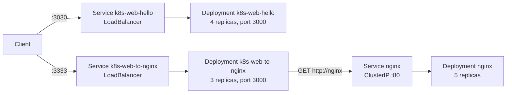

# Kubernetes_Orches

Hands-on Kubernetes practice with two small Express web servers and nginx. The repository shows how to containerize a Node.js app, deploy it with multiple replicas, expose it with a `LoadBalancer` Service, and let one app reach another workload through Kubernetes service discovery (DNS).

## Architecture



| Manifest | Resources | Image |
| --- | --- | --- |
| `deployment.yaml` | Deployment `k8s-web-hello` (4 replicas, container port 3000) | `ahmed2docker4iot/k8s-web-hello` |
| `service.yaml` | Service `k8s-web-hello`, type `LoadBalancer`, port 3030 -> 3000 | |
| `k8s-web-to-nginx.yaml` | Service `k8s-web-to-nginx` (`LoadBalancer`, 3333 -> 3000) and Deployment (3 replicas) | `ahmed2docker4iot/k8s-web-to-nginx` |
| `nginx.yaml` | Service `nginx` (ClusterIP, port 80) and Deployment (5 replicas) | `nginx` |

Every container has resource limits of 128Mi memory and 250m CPU.

## Applications

### k8s-web-hello (repository root)

`index.mjs` is an Express server on port 3000.

- `GET /` returns `VERSION 2:  Hello from the <hostname>`. In a cluster the hostname is the pod name, so repeated requests show which replica answered.

### k8s-web-to-nginx (`k8s-web-to-nginx/`)

An Express server on port 3000 that calls another service by its Kubernetes DNS name.

- `GET /` returns `Hello from the <hostname>`.
- `GET /nginx` fetches `http://nginx` (the `nginx` Service) with `node-fetch` and returns the nginx welcome page.

## Tech stack

- Node.js, Express 4, node-fetch 3 (ES modules)
- Docker (`node:alpine` base image)
- Kubernetes: Deployments and Services (`LoadBalancer`, `ClusterIP`)
- nginx

## Prerequisites

- Docker
- A Kubernetes cluster and `kubectl` (for example minikube or Docker Desktop's Kubernetes)
- Node.js and npm, to run the apps locally

## Run locally

```bash
npm install
npm start                 # http://localhost:3000

cd k8s-web-to-nginx
npm install
npm start                 # http://localhost:3000 (the /nginx route only works inside the cluster)
```

## Build the images

The manifests reference images on Docker Hub under `ahmed2docker4iot`. To use your own, build and push them, then update the `image:` fields:

```bash
docker build -t <your-user>/k8s-web-hello .
docker push <your-user>/k8s-web-hello

docker build -t <your-user>/k8s-web-to-nginx ./k8s-web-to-nginx
docker push <your-user>/k8s-web-to-nginx
```

## Deploy to Kubernetes

```bash
# hello app: deployment + LoadBalancer service
kubectl apply -f deployment.yaml
kubectl apply -f service.yaml

# nginx first, so the "nginx" service exists when the app calls it
kubectl apply -f nginx.yaml
kubectl apply -f k8s-web-to-nginx.yaml

kubectl get deployments,pods,services
```

Reach the services:

- On a cloud cluster, use the external IP from `kubectl get services` on ports 3030 and 3333.
- On minikube, run `minikube service k8s-web-hello` and `minikube service k8s-web-to-nginx`, or `minikube tunnel` to get external IPs for `LoadBalancer` services.
- Anywhere, `kubectl port-forward service/k8s-web-to-nginx 3333:3333` and open http://localhost:3333/nginx.

Useful commands while experimenting:

```bash
kubectl scale deployment k8s-web-hello --replicas=6
kubectl rollout status deployment/k8s-web-hello
kubectl logs -l app=k8s-web-hello
```

Clean up:

```bash
kubectl delete -f k8s-web-to-nginx.yaml -f nginx.yaml -f service.yaml -f deployment.yaml
```

## Notes

- The images are referenced without a tag, so Kubernetes pulls `latest`. Pin a tag if you need reproducible rollouts.
- The `nginx` image is also unpinned.

## License

MIT. See [LICENSE](LICENSE).
